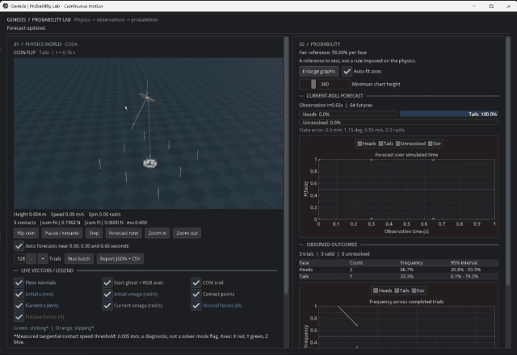

# Genesis Probability Lab

Flip a coin or roll a die inside a physics simulation and watch the odds of each outcome build up.

The simulation engine is [Genesis World](https://github.com/Genesis-Embodied-AI/genesis-world) (Apache-2.0). This folder is an example application built on top of it.

## Demo

[](Physical_AI_Probability.mp4?raw=true)

Click the preview to open the full video file (77 seconds, with captions, 31 MB). Depending on the browser, it may download first.

The video shows a coin flip and a die roll, the forecast curves while a toss is still in the air, and a batch of 1,000 die rolls filling the frequency table.

## How it works

- The left half of the window is a coin or die dropped onto a floor. Genesis integrates its motion and its contacts with the rigid-body solver.
- Nothing picks the result at random. The face on top is read once the body has come to rest. The only randomness is in the launch state (orientation, spin, small velocity changes), and each trial records its own seed.
- The right half shows two things. The forecast starts from the state observed during a toss at 0, 0.30 and 0.65 seconds, runs 64 slightly perturbed futures to the end, and reports how many ended on each face. The observed outcomes table counts finished trials and gives a 95% interval per face.
- A coin that stays on its edge, or runs past the 6 second limit, is counted as unresolved. It is never given a face.

## Run it

Developed on Windows 11 with Python 3.12, an NVIDIA GPU (CUDA build of PyTorch) and Genesis 1.4.6.

1. In the repository root, create a `.venv`, install PyTorch, and install this repository with `pip install -e ".[dev]"`. The dev extras include the interface library (`imgui-bundle`) and SciPy.
2. Double-click `Run-Probability-Lab.cmd`, or run:

```powershell
.venv\Scripts\python.exe -m examples.probability.app -g
```

Leave out `-g` to run on the CPU, which is slower. The first launch of an object or batch size spends about a minute compiling kernels.

In the window, pick Coin or Die under Experiment settings, then press Flip coin or Roll die, or run a batch (128 trials by default). Export JSON + CSV writes to `out/probability/`. Closing the window also saves the finished trials.

To run a fixed-size experiment without opening a window:

```powershell
.venv\Scripts\python.exe -m examples.probability.app -g --kind die --batch 256
```

## What the numbers mean

- 50% per side for the coin and 1/6 per face for the die are reference values from symmetry. Genesis does not impose them, so a gap from them is something to investigate and not something the engine forces.
- The coin is an idealized cylinder (45 mm radius, 8 mm thick, 20 g). It is not calibrated to any real coin.
- A small batch can sit away from the reference by chance. In one 256-toss coin batch with seed 2026, 98 tosses ended unresolved, so that batch says little about 50/50 behavior of the coin overall (see `DETAILS.md`).
- The simulation has not been compared with real tossed coins or dice yet. The comparison tools below ship with synthetic placeholder charts, and the charts are labeled as such.

## Files

| Path | Purpose |
| --- | --- |
| `app.py` | The window and the command line |
| `worker.py` | A background worker that runs the physics and sends frames and forecasts to the window |
| `world.py` | Builds the Genesis scene: floor, coin or die, contact and friction settings |
| `compare_real.py` | Compares tracked real tosses with Genesis replays of their release states (see `COMPARISON.md`) |
| `published_reference.py` | Compares a coin batch with a published real-world experiment (see `PUBLISHED_COMPARISON.md`) |
| `DETAILS.md` | The full method, conventions, statistics and validation notes |

The tests are in `tests/core/test_probability*.py`.
